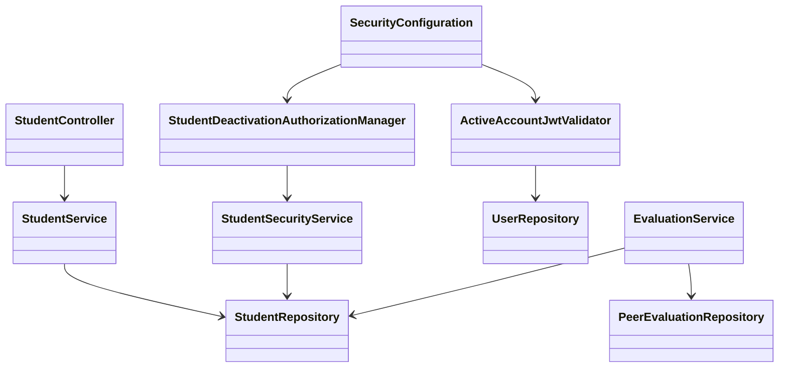

# Students (STU) Design

> Realizes: [UC-STU-deactivate-student](../requirements/use-cases.md#uc-stu-deactivate-student-the-course-admininstructor-deactivates-a-student)
> Depends on FRs: FR-SEC-authentication, FR-SEC-authorization, FR-SEC-deny-unauthorized, FR-SEC-active-account
> See: [business rules](../requirements/business-rules.md), [SRS](../requirements/software-requirements-specification.md#security-and-authorization-requirements), [containers](architectural-design.md#containers), [crosscutting concepts](architectural-design.md#crosscutting-concepts), [shared data model](../requirements/software-requirements-specification.md#business-domain-model)
> Stage: proposed design-of-record; implementation waits for the design pull request to merge. Shape approved by the developer in conversation.

## Overview

Extend the existing student vertical slice, shared JWT security, and evaluation slice. Preserve the account and existing membership graph; use the existing `enabled` attribute as the only lifecycle state. This document designs deactivation, not UC-STU-reactivate-student. Baseline is `59f0267`.

## Components & classes



- **Reused, extended:** [StudentController](../../backend/src/main/java/team/projectpulse/student/StudentController.java), [StudentService](../../backend/src/main/java/team/projectpulse/student/StudentService.java), [StudentRepository](../../backend/src/main/java/team/projectpulse/student/StudentRepository.java), [StudentSecurityService](../../backend/src/main/java/team/projectpulse/student/StudentSecurityService.java), and the existing student DTO/converter. Add `deactivateStudent`, a caller-scoped repository finder, and `canDeactivateStudent`.
- **New:** `security/authorizationmanagers/StudentDeactivationAuthorizationManager.java` delegates to `StudentSecurityService.canDeactivateStudent`; `security/ActiveAccountJwtValidator.java` implements Spring's `OAuth2TokenValidator<Jwt>` using the existing [UserRepository](../../backend/src/main/java/team/projectpulse/user/UserRepository.java).
- **Reused, extended:** [SecurityConfiguration](../../backend/src/main/java/team/projectpulse/security/SecurityConfiguration.java) composes the account validator with Spring's default timestamp validation and retains the existing RSA decoder. Existing authentication entry point and exception advice produce the standard error envelope.
- **Reused, extended:** [EvaluationService](../../backend/src/main/java/team/projectpulse/evaluation/EvaluationService.java) checks evaluatee status before creating an evaluation and selects weekly historical rows; [PeerEvaluationRepository](../../backend/src/main/java/team/projectpulse/evaluation/PeerEvaluationRepository.java) supplies the requested week's recorded evaluatee IDs in one query.
- **Reused, extended:** [student API module](../../frontend/src/apis/student/index.ts), [Students.vue](../../frontend/src/pages/students/Students.vue), and [EditStudentForm.vue](../../frontend/src/pages/students/EditStudentForm.vue). The edit dialog already loads student details; put the named Deactivate control and Element Plus confirmation there. Notify the parent to refresh after success. Do not send unsaved profile edits with deactivation.
- **Reused, extended:** [SubmitTeamsEvaluations.vue](../../frontend/src/pages/evaluations/SubmitTeamsEvaluations.vue) filters disabled students only when constructing new evaluation rows. Existing evaluations remain available under their existing editing-window rules.
- **Reused without behavior changes:** [SubmissionStatusService](../../backend/src/main/java/team/projectpulse/notification/SubmissionStatusService.java), the shared Axios instance, `UserUtils`, and existing report score/comment aggregation.

## Sequence

### UC-STU-deactivate-student: confirmation and persistence

```mermaid
sequenceDiagram
    actor Instructor
    participant UI as Student details
    participant Security
    participant Service as Student service
    participant DB as Database
    Instructor->>UI: View selected student (steps 1-2)
    Instructor->>UI: Choose Deactivate (step 3)
    UI-->>Instructor: Named warning and Confirm/Cancel (step 4)
    alt Cancel or dismiss (E1)
        UI-->>Instructor: Close warning; send no request
    else Confirm (step 5)
        UI->>Security: PUT /students/{studentId}/deactivation
        Security->>Security: Validate token and current account; authorize target
        Security->>Service: deactivateStudent(studentId)
        Service->>DB: Find target within caller's assigned/owned scope
        Service->>DB: Set enabled=false in transaction (step 6; E2 is a no-op)
        DB-->>Service: Commit; membership and work unchanged
        Service-->>UI: Result with disabled StudentDto
        UI-->>Instructor: Success; refresh status (steps 6-7)
    end
```

### Subsequent access and evaluation history

```mermaid
sequenceDiagram
    actor Caller
    participant API
    participant Validator as Active account validator
    participant DB as Database
    Caller->>API: Protected request with signed JWT (E5)
    API->>Validator: Validate userId and current account
    Validator->>DB: Read account enabled state by token userId
    alt Disabled, absent, or invalid identity
        Validator-->>API: invalid_token
        API-->>Caller: 401 Result; client clears login state
    else Active account
        Validator-->>API: Continue existing authorization
    end
    Caller->>API: Authorized weekly report request (E7)
    API->>DB: Load course section students and recorded evaluatee IDs for week
    API->>API: Active team members plus disabled students with saved evaluations
    API-->>Caller: Existing aggregation and visibility rules
```

E3/E4 fail before writes; E8 rolls back a failed transaction and leaves a lost response safe to retry. Deactivation affects requests authenticated after commit; this design does not cancel already-running requests.

## API contract

All paths below are relative to `/api/v1`; responses use `Result`. No new request DTO or request body is needed for deactivation.

| Endpoint | Caller | Request | Success | Errors / extensions |
|---|---|---|---|---|
| **New** `PUT /students/{studentId}/deactivation` | Instructor assigned to target's course section, or course admin owning target's course | Path `studentId`; no body | `200`, disabled `StudentDto`; repeated request returns the same state (E2) | `401` unauthenticated/disabled caller (E3/E5); `403` student, outsider, invalid or missing target at route gate (E3/E4); `404` if target disappears or leaves scope between route gate and scoped service lookup (E4); existing `5xx` error handling for transaction failure (E8) |
| **Changed** `PUT /students/{studentId}` | Existing authorized callers | Existing validated profile DTO | Existing profile update response; unchanged status accepted | `400` if profile editing attempts active-to-disabled transition; no deactivation through this route. Existing inactive-to-active behavior stays as-is; no new reactivation flow |
| **Changed** `POST /evaluations` | Existing authorized evaluator | Existing validated evaluation DTO | Existing response for active evaluatee | `400` with explicit inactive-evaluatee message for new evaluation of disabled student (E6); existing team/window checks retained |
| **Changed** `GET /evaluations/sections/{sectionId}/week/{week}` | Existing authorized course-section report reader | Existing path parameters | Existing weekly report DTO, selected under BR-evaluation-deactivated-history (E7) | Existing authentication and scope errors |
| All JWT-authenticated routes | Existing authorized caller with active account | Existing Bearer token | Existing response | `401` for a disabled/deleted account or missing/malformed `userId`, even with valid signature and expiry (E5) |

E1 sends no API request. The report path above is the existing controller mapping; it is not a new route.

## Key decisions

- **Retain membership**, under BR-student-deactivation-membership. Removing her would alter the historical roster and make reactivation require reconstruction. No membership snapshot or new deactivation timestamp is introduced.
- **Separate obligation from history.** BR-submission-owed remains the single source for reminders. Report inclusion is active team members plus disabled students with recorded evaluations for the requested week; include disabled historical evaluatees even if membership changes independently afterward. Reject filtering every disabled student, which erases historical results, and keeping every empty disabled row, which suggests ongoing obligations. Read week-specific IDs once, rather than issuing one existence query per student. Preserve evaluations authored by her when aggregating teammates' results.
- **Validate the live account during JWT decoding**, alongside default validation, instead of waiting up to two hours for expiry or introducing a token blocklist. Use the signed `userId` against `UserRepository`, not the mutable username. This validator runs before a caller exists in the security context, so `UserUtils` is not an identity source here; normal services use `UserUtils`. Apply the shared active-account requirement to students and instructors. Re-enabling an account may allow a still-unexpired token again; permanent token revocation is outside FR-SEC-active-account and this use case.
- **Authorize twice.** A dedicated manager restricts roles and target scope; a repository query binds `studentId` to the caller ID through either assigned course-section instructors or course ownership. Both use the same predicate, independent of the caller's selected default course section. Do not reuse `StudentInstructorAuthorizationManager` unchanged: it does not cover course ownership and changing it would alter unrelated report access. A nonexistent target returns `403` at this gate, matching current fail-closed security conventions; a post-gate race returns `404` from the scoped finder.
- **Dedicated transition, idempotent retry.** Only the new action can perform active-to-disabled changes. A profile request attempting that transition fails before updating other fields. Preserve the existing inactive-to-active path rather than build or remove reactivation in this change. If the student is already inactive, return the stored DTO without saving again.
- **Check eligibility at the server.** Filter new browser rows for usability, then recheck the persisted evaluatee at submission; client filtering alone cannot stop a stale page or crafted request. An evaluation update remains governed by its stored record and the existing window checks; deactivation does not silently freeze or delete old evaluations.
- **Keep cancellation local.** Confirmation sends only the student ID; cancelling or dismissing sends nothing. Disable duplicate confirmation while a request is pending, refresh only after success, and never toast success after an error. A response lost after commit can be reconciled by a reload or repeated request.

## Data model

No schema delta, migrations, or seed changes. Reuse `PeerEvaluationUser.enabled`, existing student membership, and saved evaluations from the [Business Domain Model](../requirements/software-requirements-specification.md#business-domain-model). No lifecycle state beyond active/inactive is introduced.

## Reuse & cross-cutting

Follow the [architectural conventions](architectural-design.md#architectural-conventions): constructor injection, transactions at the service, caller identity through `UserUtils`, a standard `Result` envelope, and the shared Axios client. Reuse Spring's existing login enabled check and authentication error mapping. No email is sent for deactivation; reminders continue to use the notification slice. No locking, autosave, RAM graph, or external service changes are needed.

The architecture-of-record's Authentication section is amended in this design pull request to distinguish current-account checks from permanent per-token revocation. The container and component boundaries do not change.

## Tests

Each row is a definition of done, not a claim that tests already exist or have run. Unit tests cover services and validator; integration tests cover real signed tokens, database queries, HTTP authorization/error envelopes, and persisted preservation. Cypress covers actual dialog and browser behavior.

| Row | Flow / oracle | Level | Assertion |
|---|---|---|---|
| T1 | Main steps 1-7; BR-student-lifecycle | Integration + Cypress | View the named student; dedicated control shows all warning consequences; confirmation sends the new request, disables account, refreshes status, and reports success |
| T2 | POST-2; BR-student-deactivation-membership | Integration | Account ID, course section, team, activities, authored evaluations, received evaluations, ratings and comments are unchanged after deactivation; teamless student also succeeds |
| T3 | E1 | Cypress | Cancel, Escape, and close leave status/work unchanged and send zero deactivation requests; unsaved profile edits are not submitted |
| T4 | E2 | Unit + integration | Repeated request succeeds with disabled DTO; no repeated save or membership/work change, including a request made after another caller disabled the account |
| T5 | E3; BR-student-lifecycle / BR-section-scoped-access | Integration | Assigned instructor and owning course admin succeed, including when another default course section is selected; student, unrelated instructor and unrelated admin get `403`; anonymous caller gets `401`; refusals do not write |
| T6 | E4 | Unit + integration | Missing/malformed target denied at route; target missing/out of scope after route evaluation yields `404` from scoped service lookup; no primary-key-only load or write |
| T7 | E5; FR-SEC-active-account | Unit + integration | Real token issued before deactivation gets `401` on subsequent protected reads and writes; fresh login refused; active token still works; signature/expiry validation retained; deleted/malformed identity refused; shared validator also refuses disabled instructor |
| T8 | E6; BR-evaluation-active-evaluatee | Unit + integration + Cypress | Disabled evaluatee cannot receive a new evaluation, including for a pre-deactivation week and through a stale page; active evaluatee succeeds; new browser rows exclude disabled teammates |
| T9 | E6; BR-evaluation-editable-until-close / BR-evaluation-submission-window | Unit + integration | Existing evaluation of disabled student remains editable by active evaluator within its window and read-only after window closes; existing browser rows remain accessible |
| T10 | E7; BR-evaluation-deactivated-history | Unit + integration | Disabled student with evaluations for requested week remains with identical scores/comments; disabled student with no evaluations that week is absent; active team member with no evaluations stays; historical disabled evaluatee without current team is retained; authored evaluations still contribute to teammates; private comments retain existing visibility |
| T11 | E7; BR-submission-owed | Unit + integration | Disabled student owes neither item and receives no reminder; active teammates complete obligations without evaluating her; saved historical report rows do not create obligations |
| T12 | Associated Information: dedicated action | Unit + integration + Cypress | Profile update cannot disable account; rejected mixed profile/status update changes nothing; unchanged status/profile updates and existing inactive-to-active behavior still work; active edit form offers only dedicated deactivation |
| T13 | E8 | Unit + integration + Cypress | Save failure rolls back and shows no success; failed request leaves UI state honest; reload/retry after response loss reconciles the committed state safely |

## Build order and review

1. **Trunk commit(s):** live-account JWT validator; scoped lifecycle service/query and profile-bypass protection; evaluation creation/report selection. Carry targeted tests with the relevant change. Stop after the shared trunk for developer review before adding leaves.
2. **Security-rule commit:** deactivation authorization manager and explicit route rule, with refusal tests.
3. **Leaf commits:** controller/API contract and UI flows, with tests. Update traceability from actual passing coverage, never the planned list alone.
4. Run full backend tests with Docker, frontend checks and Cypress; deliberately mutate one production line, run the corresponding test, record red/green honestly, then restore it. The developer performs the assignment's personal review; agent findings are not represented as the developer's review.

## Open questions / risks

- No blocking policy question remains after developer approval. The design pull request still must merge before implementation.
- Account checks add a database read to JWT authentication; intentionally no cache that could postpone deactivation. Database outages fail authentication rather than granting access.
- In-flight requests can finish; no row-locking protocol across evaluation submission and deactivation is introduced. Tests establish the guarantee for requests begun after deactivation commits.
- Existing reactivation through profile editing is retained, not redesigned. Its dedicated confirmation and notification remain future work.
- A fresh-context questions test and its actual findings belong in the design pull request; do not claim it ran before it does. Git/GitHub access and Docker availability must be verified before promising commits, remote artifacts, or executable checks.
